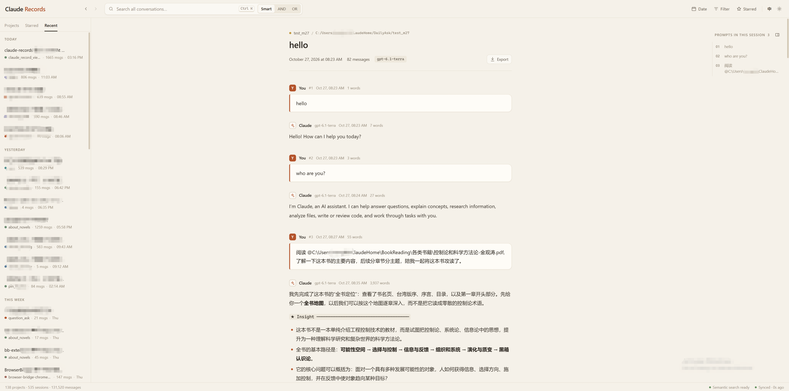
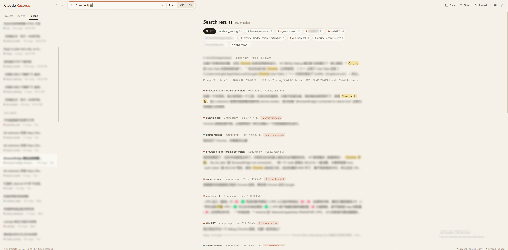

<div align="center">


# Claude Records

**Browse, search and archive every conversation you have had with Claude Code — a calm, local-first web app.**

[](LICENSE)
[](https://www.python.org/)
[](https://nodejs.org/)
[](#quick-start)
[](https://claude.com/claude-code)

**English** · [简体中文](README.zh-CN.md)

[Features](#features) · [Quick start](#quick-start) · [Usage](#using-it) · [Semantic search](#semantic-search-optional) · [Configuration](#configuration)

</div>

<br>



> Not affiliated with or endorsed by Anthropic. "Claude" and "Claude Code" are trademarks of Anthropic.

## Why

Claude Code writes every session to JSONL files under `~/.claude/projects/`. They are hard to read, impossible to search across projects, and Claude Code **deletes transcripts older than 30 days** by default (`cleanupPeriodDays`).

Claude Records indexes those files into a local database and gives you:

- **A reader** — every project and session, with your prompts and Claude's answers rendered as proper Markdown (code, tables, math, images).
- **Search across everything** — keyword search with Chinese word segmentation, plus optional *semantic* search that finds the conversation even when you remember the idea but not the words.
- **An archive** — sessions stay here after Claude Code has cleaned them up.

Everything runs on your machine. Nothing is uploaded anywhere.

## Features

- **Projects, sessions, recent and starred lists** — sessions grouped by day, live-updating while a Claude Code session is still running
- **Readable conversations** — numbered prompt cards, Markdown / code highlighting / KaTeX / images, and a clickable outline of all prompts in the session
- **Fast search** — `Ctrl K` from anywhere; AND / OR / Smart modes; filter by date and by project; results load as you scroll
- **Semantic search (optional)** — keyword and embedding results fused together, fully local via [Ollama](https://ollama.com)
- **Back / forward** — jump from a search result into a session and back without losing your place (browser buttons, `Alt+←/→`, mouse side buttons)
- **Organise** — star messages and sessions, rename sessions and projects
- **Export** — any session to Markdown or a self-contained HTML page
- **Light & dark** — a warm "paper" light theme and a "graphite" dark theme, following your system by default
- **English / 中文 UI** — follows the browser language, switchable in the header
- **Private by design** — local SQLite index, served only on `localhost`, requests from other websites are rejected

## Quick start

Requirements: **Python 3.10+** and **Node.js 20+** (Node is only needed once, to build the web UI).

```bash
git clone https://github.com/axzml/claude-records.git
cd claude-records

cd frontend && npm install && npm run build && cd ..
pip install -e .

claude-records
```

On the first start it indexes all your existing transcripts (a few seconds to a minute, depending on how much history you have), then opens `http://localhost:9966` in your browser. After that, new conversations are picked up automatically while it runs.

From now on just run `claude-records` from any directory.

## Using it

**Read a session** — pick a project on the left (or switch to *Recent* / *Starred*), then a session. Your prompts are the numbered cards; the outline on the right lists every prompt in the session — click one to jump to it. Collapse the outline with its button if you want more room.

**Choose what to show** — the *Filter* menu in the header toggles system messages, progress messages, tool calls, and whether every intermediate Claude reply is shown or only the final reply of each turn (the default).

**Search** — press `Ctrl K` (or click the search box), type and press `Enter`.

| Mode | Finds |
|---|---|
| **Smart** | keyword matches *and* semantically related messages (needs Ollama, otherwise behaves like AND) |
| **AND** | messages containing all words |
| **OR** | messages containing any word |



Narrow results with the *Date* menu or the project tags above the results. Click a result to open the session at that message; use back (`Alt+←`) to return to the results exactly where you left off.

**Keep things** — hover a message or session to star or rename it. *Starred* in the header lists starred messages; the *Starred* tab in the sidebar lists starred sessions.

**Export** — open a session and use *Export* → Markdown or HTML.

**Appearance & language** — the buttons at the top right switch `EN` / `中` and cycle system / light / dark.

### Command-line options

```bash
claude-records                 # start on port 9966 (or the next free port) and open the browser
claude-records --port 8080     # use another port
claude-records --no-browser    # don't open the browser
```

## Semantic search (optional)

Smart mode can also match by meaning, using a local embedding model served by Ollama:

```bash
pip install -e ".[semantic]"       # adds numpy
# install Ollama from https://ollama.com, then:
ollama pull qwen3-embedding:4b     # ~2.5 GB, runs on GPU or CPU
```

Restart `claude-records`. It embeds your prompts and answers in the background, newest first — the status bar shows progress — and keeps up with new messages. If Ollama is not running, search silently falls back to keywords.

## Configuration

| Environment variable | Default | Meaning |
|---|---|---|
| `CLAUDE_RECORDS_DATA_DIR` | see below | Where the index and your stars/renames are stored |
| `CLAUDE_CONFIG_DIR` | `~/.claude` | Claude Code's config directory (same variable Claude Code uses) |
| `CLAUDE_RECORDS_EMBED_MODEL` | `qwen3-embedding:4b` | Ollama embedding model; set to empty to disable semantic search |
| `OLLAMA_HOST` | `127.0.0.1:11434` | Ollama address |

Default data directory:

| OS | Location |
|---|---|
| Windows | `%LOCALAPPDATA%\claude-records` |
| macOS | `~/Library/Application Support/claude-records` |
| Linux | `$XDG_DATA_HOME/claude-records` (usually `~/.local/share/claude-records`) |

It holds `records.db` (the index — keep it if you want the archive) and `user_prefs.json` (your stars and renames, which survive a rebuilt index).

## Privacy & security

- Transcripts are only read from your Claude Code directory and indexed into a local SQLite file.
- The server listens on `localhost` only and refuses requests from other websites (Host, Origin and fetch-metadata checks, no CORS), so a web page open in your browser cannot read your conversations.
- Local images referenced in conversations are served only from your project directories, and only as images.
- Semantic search talks only to your local Ollama.

## Development

```bash
python viewer.py            # backend on :9966
cd frontend && npm run dev  # UI with hot reload; API requests are proxied to the backend
```

<details>
<summary>Project layout</summary>

```
claude-records/
├── viewer.py              # launcher (the `claude-records` command)
├── backend/
│   ├── app.py             # Flask API
│   ├── indexer.py         # JSONL parsing & incremental sync
│   ├── models.py          # SQLite schema, migrations, data directory
│   ├── search.py          # FTS5 keyword + hybrid search
│   ├── embedding.py       # optional Ollama embeddings & vector index
│   └── user_prefs.py      # stars / renames that survive re-indexing
├── frontend/src/          # React + TypeScript UI (built into backend/static)
└── docs/images/           # screenshots
```

</details>

<details>
<summary>HTTP API</summary>

| Method | Endpoint | Description |
|--------|----------|-------------|
| GET | `/api/projects` | List projects |
| GET | `/api/project/:id` | Project details |
| GET | `/api/sessions/:projectId` | Sessions of a project |
| GET | `/api/sessions/recent` | 50 most recent sessions |
| GET | `/api/sessions/starred` | Starred sessions |
| GET | `/api/messages/:sessionId` | Messages of a session |
| POST | `/api/search` | Search (`query`, `mode`, `project_id`, `time_from`, `time_to`, `types`, `page`) |
| GET | `/api/starred` | Starred messages |
| POST | `/api/star/:messageId` | Toggle message star |
| POST | `/api/session/star/:sessionId` | Toggle session star |
| PUT | `/api/session/rename/:sessionId` | Rename a session |
| PUT | `/api/project/rename/:projectId` | Rename a project |
| GET | `/api/sync/status` | Sync status (starts a sync when files changed) |
| POST | `/api/sync/trigger` | Run a sync now |
| GET | `/api/file/image?path=` | Serve a local image referenced in a conversation |

</details>

Built with Python, Flask, SQLite FTS5, jieba, React, TypeScript and Vite.

## License

[MIT](LICENSE)
