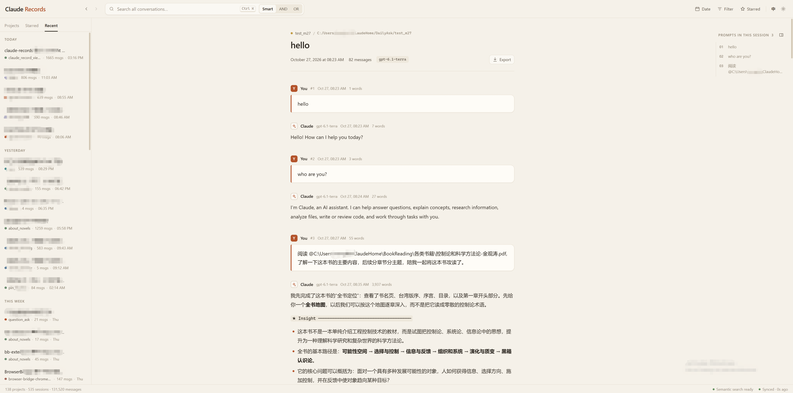
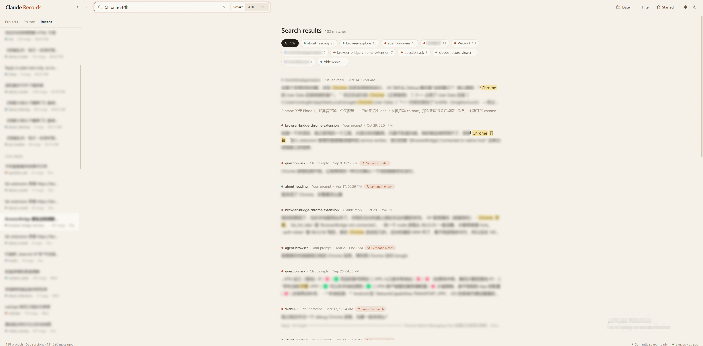

<div align="center">


# Claude Records

**浏览、搜索并永久保存你和 Claude Code 的每一段对话 —— 一个安静的本地网页应用。**

[](LICENSE)
[](https://www.python.org/)
[](https://nodejs.org/)
[](#快速开始)
[](https://claude.com/claude-code)

[English](README.md) · **简体中文**

[功能](#功能) · [快速开始](#快速开始) · [使用方法](#使用方法) · [语义搜索](#语义搜索可选) · [配置](#配置)

</div>

<br>



> 本项目与 Anthropic 无关，也未获其认可。"Claude" 和 "Claude Code" 是 Anthropic 的商标。

## 为什么需要它

Claude Code 会把每个会话写成 `~/.claude/projects/` 下的 JSONL 文件。这些文件很难阅读，没法跨项目搜索，而且 Claude Code 默认会**删除 30 天前的对话记录**（`cleanupPeriodDays`）。

Claude Records 把这些文件索引进本地数据库，给你：

- **一个阅读器**：所有项目和会话，你的提问和 Claude 的回答都按 Markdown 正常渲染（代码、表格、公式、图片）。
- **全局搜索**：支持中文分词的关键词搜索，还可选「语义搜索」，只记得大意、记不清原话也能找到那段对话。
- **一份存档**：Claude Code 清理掉的会话，在这里依然能看、能搜。

一切都在你自己的电脑上运行，不会上传任何数据。

## 功能

- **项目、会话、最近、收藏**：会话按天分组；Claude Code 会话还在进行时，内容会实时更新
- **好读的对话**：带编号的提问卡片，Markdown / 代码高亮 / KaTeX 公式 / 图片，右侧有可点击跳转的「本会话提问」目录
- **快速搜索**：任意位置按 `Ctrl K`；智能 / AND / OR 三种模式；按日期、按项目筛选；结果随滚动自动加载
- **语义搜索（可选）**：关键词结果与语义结果融合排序，通过 [Ollama](https://ollama.com) 完全本地运行
- **后退 / 前进**：从搜索结果点进会话再返回，位置不丢（浏览器按钮、`Alt+←/→`、鼠标侧键都可以）
- **整理**：收藏消息和会话，给会话和项目改名
- **导出**：任意会话导出为 Markdown 或独立的 HTML 网页
- **浅色与深色**：暖色「纸本」浅色主题和「石墨」深色主题，默认跟随系统
- **中文 / English 界面**：跟随浏览器语言，顶部可切换
- **注重隐私**：索引存在本地 SQLite，只在 `localhost` 提供服务，拒绝来自其他网站的请求

## 快速开始

需要 **Python 3.10+** 和 **Node.js 20+**（Node 只在构建网页界面时用一次）。

```bash
git clone https://github.com/axzml/claude-records.git
cd claude-records

cd frontend && npm install && npm run build && cd ..
pip install -e .

claude-records
```

第一次启动会先索引你已有的全部对话记录（视历史多少，几秒到一分钟），然后在浏览器中打开 `http://localhost:9966`。之后只要它在运行，新对话都会自动收录。

以后在任意目录运行 `claude-records` 即可。

## 使用方法

**阅读会话**：在左侧选择项目（或切换到「最近」「收藏」），再选择会话。带编号的卡片是你的提问；右侧目录列出了本会话的所有提问，点击即可跳转。觉得占地方，可以用目录上的按钮收起。

**选择显示内容**：顶部的「筛选」菜单可以开关系统消息、进度信息、工具调用，以及显示每轮的全部回复还是只显示最后一条回复（默认）。

**搜索**：按 `Ctrl K`（或点击搜索框），输入后按回车。

| 模式 | 找到的内容 |
|---|---|
| **智能** | 关键词匹配的消息，**加上**语义相关的消息（需要 Ollama，否则等同 AND） |
| **AND** | 同时包含所有关键词的消息 |
| **OR** | 包含任一关键词的消息 |



可以用「时间」菜单或结果上方的项目标签缩小范围。点击结果会打开对应会话并定位到那条消息；按后退（`Alt+←`）回到搜索结果，位置和刚才完全一样。

**收藏与改名**：鼠标悬停在消息或会话上，就会出现收藏和改名按钮。顶部的「收藏」列出收藏的消息，左侧的「收藏」标签页列出收藏的会话。

**导出**：打开会话后，点「导出」，选择 Markdown 或 HTML。

**外观与语言**：右上角的按钮可以切换 `EN` / `中`，以及在跟随系统 / 浅色 / 深色之间切换。

### 命令行参数

```bash
claude-records                 # 在 9966 端口启动（被占用则自动顺延），并打开浏览器
claude-records --port 8080     # 指定端口
claude-records --no-browser    # 不自动打开浏览器
```

## 语义搜索（可选）

智能模式还可以按「意思」匹配，用的是 Ollama 提供的本地向量模型：

```bash
pip install -e ".[semantic]"       # 安装 numpy
# 从 https://ollama.com 安装 Ollama，然后：
ollama pull qwen3-embedding:4b     # 约 2.5 GB，GPU 或 CPU 均可运行
```

重启 `claude-records`。它会在后台为你的提问和回答建立向量索引，从最新的开始，状态栏会显示进度，之后新消息也会自动跟上。Ollama 没运行时，搜索会自动退回关键词模式。

## 配置

| 环境变量 | 默认值 | 说明 |
|---|---|---|
| `CLAUDE_RECORDS_DATA_DIR` | 见下表 | 索引和收藏 / 改名记录的存放位置 |
| `CLAUDE_CONFIG_DIR` | `~/.claude` | Claude Code 的配置目录（与 Claude Code 使用同一个变量） |
| `CLAUDE_RECORDS_EMBED_MODEL` | `qwen3-embedding:4b` | Ollama 向量模型；设为空则关闭语义搜索 |
| `OLLAMA_HOST` | `127.0.0.1:11434` | Ollama 地址 |

默认数据目录：

| 系统 | 位置 |
|---|---|
| Windows | `%LOCALAPPDATA%\claude-records` |
| macOS | `~/Library/Application Support/claude-records` |
| Linux | `$XDG_DATA_HOME/claude-records`（通常是 `~/.local/share/claude-records`） |

目录里有 `records.db`（索引，想保留存档就别删它）和 `user_prefs.json`（你的收藏和改名，索引重建后也不会丢）。

## 隐私与安全

- 只读取你的 Claude Code 目录中的对话记录，并索引到本地 SQLite 文件。
- 服务只监听 `localhost`，并拒绝来自其他网站的请求（检查 Host、Origin 和 Fetch Metadata，不开放 CORS），所以浏览器里打开的其他网页读不到你的对话。
- 对话中引用的本地图片只会从你的项目目录中读取，而且只作为图片提供。
- 语义搜索只与你本机的 Ollama 通信。

## 开发

```bash
python viewer.py            # 后端，端口 9966
cd frontend && npm run dev  # 界面热更新；API 请求会代理到后端
```

<details>
<summary>项目结构</summary>

```
claude-records/
├── viewer.py              # 启动器（即 claude-records 命令）
├── backend/
│   ├── app.py             # Flask API
│   ├── indexer.py         # JSONL 解析与增量同步
│   ├── models.py          # SQLite 表结构、迁移、数据目录
│   ├── search.py          # FTS5 关键词 + 混合搜索
│   ├── embedding.py       # 可选的 Ollama 向量与向量索引
│   └── user_prefs.py      # 重建索引后依然保留的收藏 / 改名
├── frontend/src/          # React + TypeScript 界面（构建到 backend/static）
└── docs/images/           # 截图
```

</details>

<details>
<summary>HTTP 接口</summary>

| 方法 | 路径 | 说明 |
|--------|----------|-------------|
| GET | `/api/projects` | 项目列表 |
| GET | `/api/project/:id` | 项目详情 |
| GET | `/api/sessions/:projectId` | 某项目的会话 |
| GET | `/api/sessions/recent` | 最近 50 个会话 |
| GET | `/api/sessions/starred` | 收藏的会话 |
| GET | `/api/messages/:sessionId` | 某会话的消息 |
| POST | `/api/search` | 搜索（`query`、`mode`、`project_id`、`time_from`、`time_to`、`types`、`page`） |
| GET | `/api/starred` | 收藏的消息 |
| POST | `/api/star/:messageId` | 收藏 / 取消收藏消息 |
| POST | `/api/session/star/:sessionId` | 收藏 / 取消收藏会话 |
| PUT | `/api/session/rename/:sessionId` | 会话改名 |
| PUT | `/api/project/rename/:projectId` | 项目改名 |
| GET | `/api/sync/status` | 同步状态（文件有变化时会触发同步） |
| POST | `/api/sync/trigger` | 立即同步 |
| GET | `/api/file/image?path=` | 提供对话中引用的本地图片 |

</details>

基于 Python、Flask、SQLite FTS5、jieba、React、TypeScript 和 Vite 构建。

## 许可证

[MIT](LICENSE)
